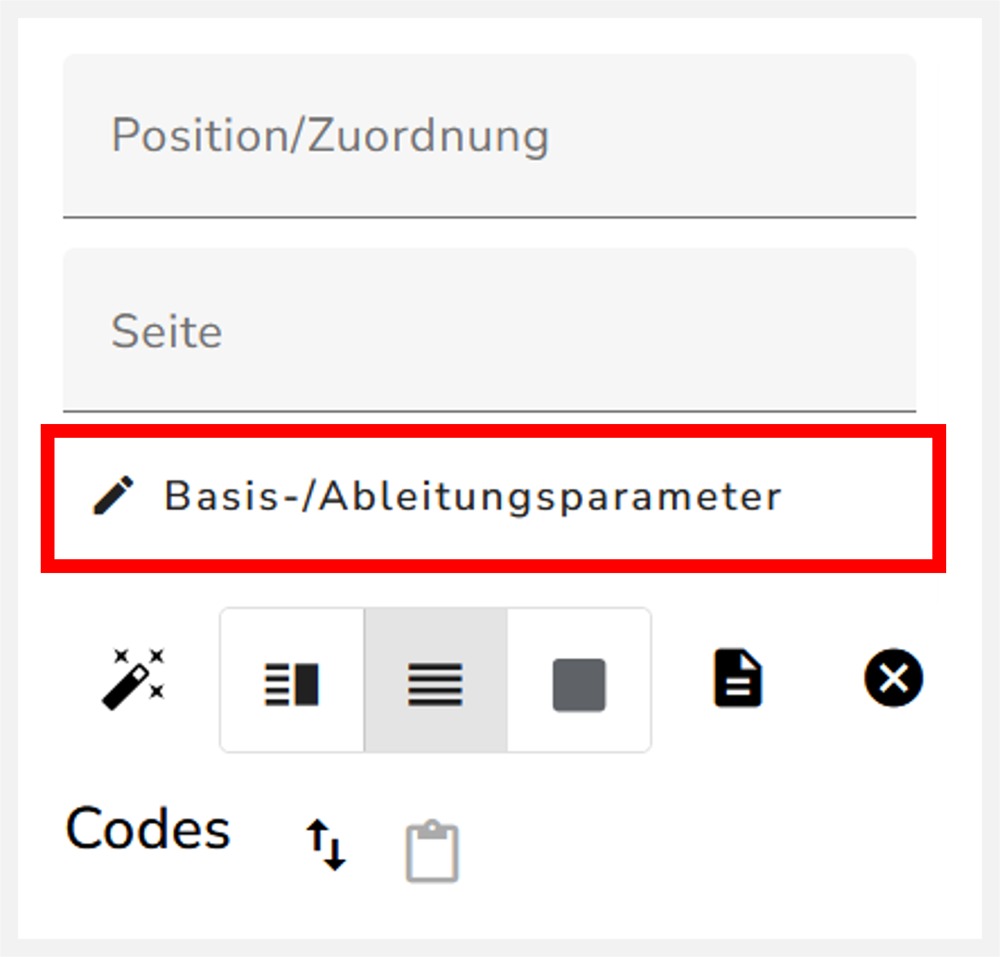
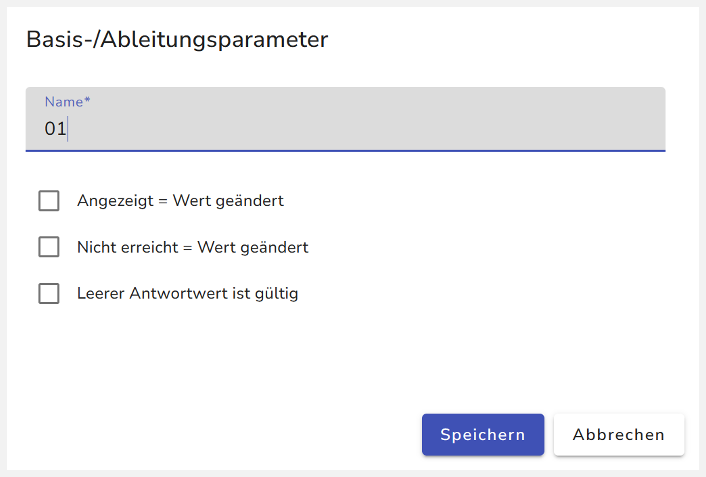

Wozu nutzt man die Basis- und Ableitungsparameter?

# Eingabe von Basis- und Ableitungsparametern

{width="382"}

## Angezeigt = Wert geändert

Wert wurde angezeigt und nicht bearbeitet (wenn Feld angezeigt wird, dann wird INTENDED_INCOMPLETE gesetzt und Kodierung läuft drüber)

## Nicht erreicht = Wert geändert

Nicht erreicht = Wert geändert: Wert wurde nicht angezeigt. Wenn die Einstellung nicht gewählt wird, dann ist der Status vom Feld „NOT-REACHED“. Wenn die Einstellung ausgewählt, dann wird Status auf „CODING_INCOMPLETE“ gesetzt.

## Leerer Antwortwert ist gültig

Leerer Antwortwert ist gültig: Wert wurde eingefügt und wieder gelöscht