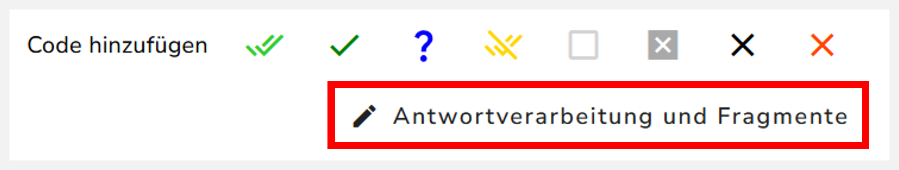
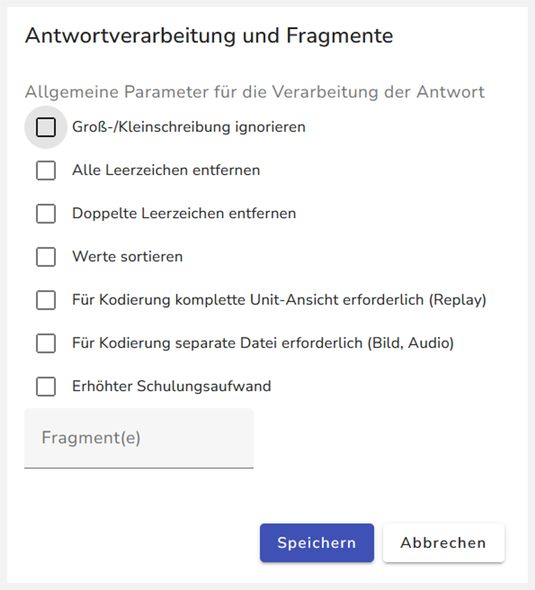

Das Menü zum Einstellen der Antwortverarbeitung finden Sie rechts unter dem Feld "Allgemeine Hinweise":

{width="389"}

Wenn Sie auf den Button klicken, öffnet sich folgendes Menü:

{width="415"}

## Groß-/Kleinschreibung ignorieren

Hier wird die Groß- und Kleinschreibung der eingegebenen Antwort ignoriert. Antworten wie zum Beipiel "brummbär" oder "bRumMBäR" werden als richtig gewertet, wenn sie mit der Regel "Zeichen/Text Übereinstimmung" mit dem Lösungstext "Brummbär" verglichen werden.

## Alle Leerzeichen entfernen

"\_ \_Brumm_bär\_" wird umgeformt zu "Brummbär" ( "\_" steht symbolisch für ein Leerzeichen " ").

::: callout-tip
## Mehrere Worte als Eingabe

Bei Eingaben mit mehreren Worten können Sie „Doppelte Leerzeichen entfernen" nutzen. Falls Sie "Alle Leerzeichen entfernen" nutzen, müssen Sie den Lösungstext ohne Leerzeichen in die Regelsätze eingeben. - Z.B. „zur_Stadt“ wird zu „zurStadt“ umgeformt
:::

## Doppelte Leerzeichen entfernen

Hier werden führende und abschließende Leerzeichen entfernt. Zwischen Textzeichen werden Leerzeichen nur entfernt, wenn sie mehr als einmal vorkommen.

- "\_ \_Brumm_bär\_ \_" wird zu "Brumm_bär"

- „\_ \_zur\_ \_Stadt“ wird zu „zur_Stadt“

## Werte sortieren

## Für Kodierung komplette Unit-Ansicht erforderlich (Replay)

## Für Kodierung separate Datei erforderlich (Bild, Audio)

## Erhöhter Schulungsaufwand

## Fragmente