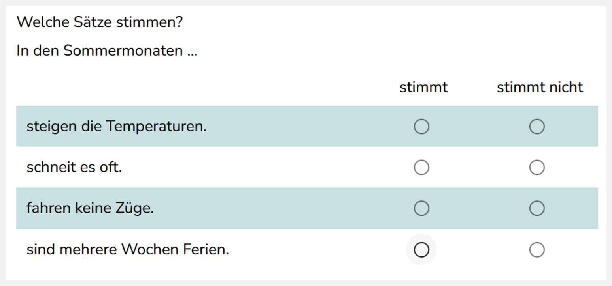
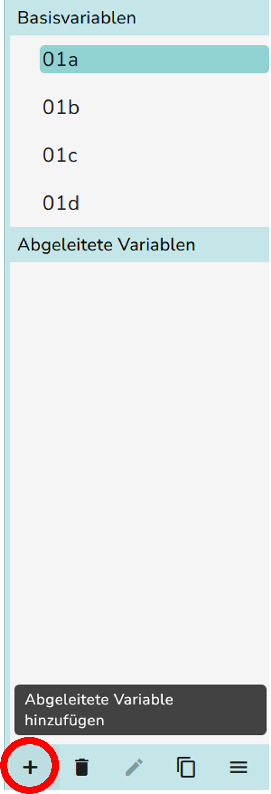
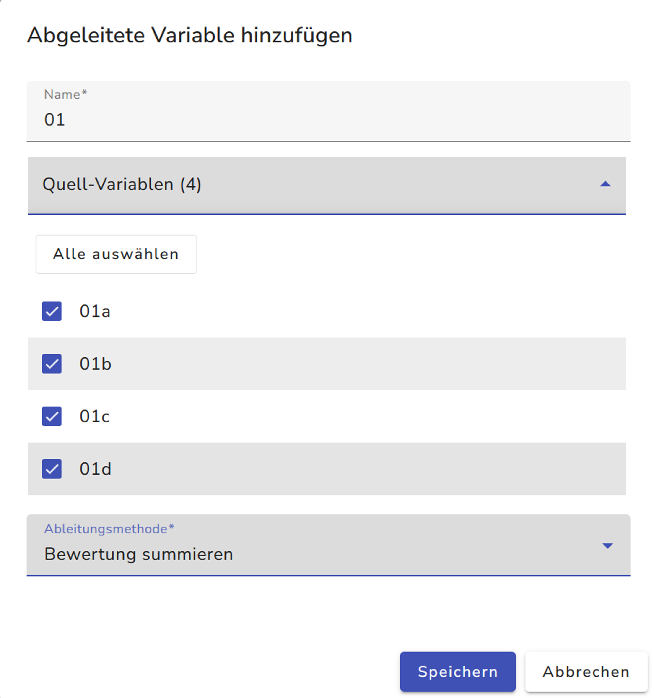
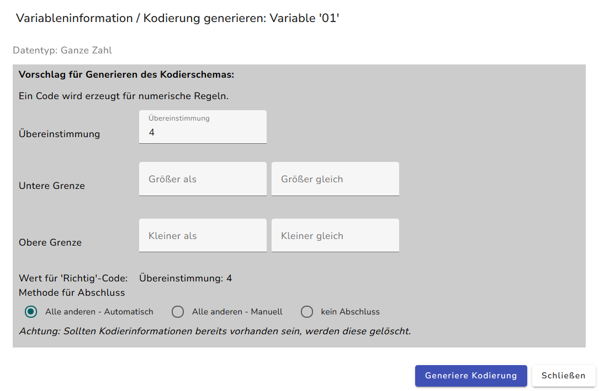
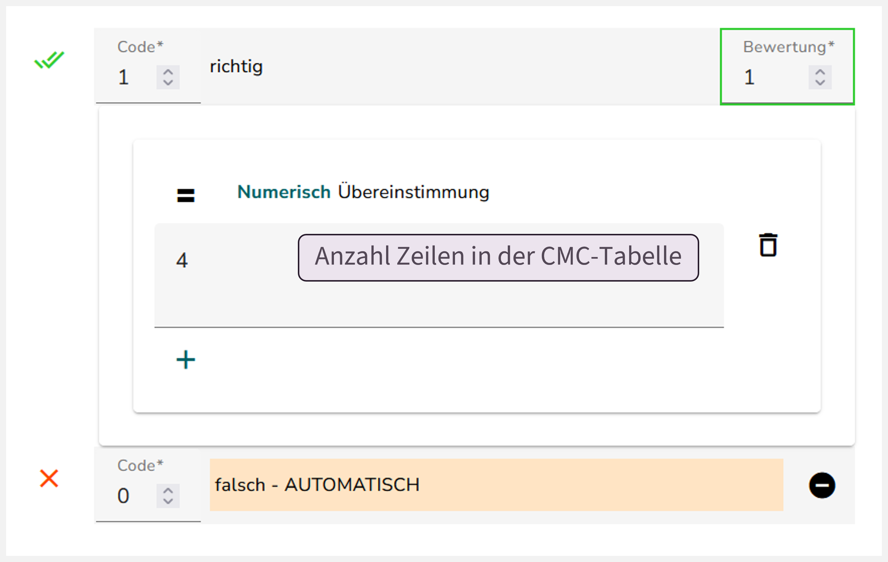

{width="498"}

## Umbenennung des Interaktionselements „Optionenfeld“

Prüfen Sie zunächst, ob für das CMC-Element (Optionsfelder) alle IDs umbenannt wurden. Die Umbenennung für CMC-Elemente wird [hier](IDs%20im%20Studio%20umbenennen%20–%20Optionentabelle%20(CMC)) erklärt.

## Kodierschema der Basisvariablen

1.  Kodierschema generieren: Im ersten Schritt geben Sie für jede Basisvariable (Zeile der CMC-Tabelle) die richtige Antwortoption an. Wählen Sie dazu eine Basisvariable aus und klicken Sie auf das Zauberstab-Symbol {width="24"}, um dort die richtige Antwortoption für die entsprechende Zeile anzugeben. Klicken Sie auf „Generiere Kodierung“.

{width="282"} {width="556"}

2.  Wiederholen Sie den Schritt mit jeder Basisvariable der CMC-Tabelle.

## Kodierschema der abgeleiteten Variable erstellen

Mit der abgeleiteten Variable wird geprüft, ob die Summe der Bewertungen über alle Zeilen der Tabelle mit dem eingetragenen Wert übereinstimmt. Das hier beschriebene Kodierschema der abgeleiteten Variable vergibt eine Bewertung mit einem Punkt, wenn alle Zeilen der Tabelle richtig beantwortet wurden. Andernfalls wird die CMC-Tabelle mit 0 Punkten bewertet.

1.  [Erstellen Sie die abgeleitete Variable](): Wählen Sie für die abgeleitete Variable alle Zeilen der CMC-Tabelle als Quellvariablen aus, und wählen Sie als Ableitungsmethode „Bewertungen summieren“. Die Variable erhält die übergeordnete ID zu den Zeilen der Tabelle (d.h. ID `03`, falls die Zeilen nach dem Schema `03a`, `03b`, … benannt sind).

{width="152"} {width="422"}

2.  Kodierschema generieren: Klicken Sie auf das Zauberstab-Symbol {width="24"} und tragen dort unter „Übereinstimmung:“ die Anzahl an Zeilen ein. Klicken Sie auf „Generiere Kodierung“.

{width="266"}

{width="492"}

Das erstellte Kodierschema sollte ungefähr so aussehen:

::: panel-tabset
## Basisvariablen

Kodierung jeder Basisvariable

## Abgeleitete Variable

Kodierung der abgeleiteten Variable

:::