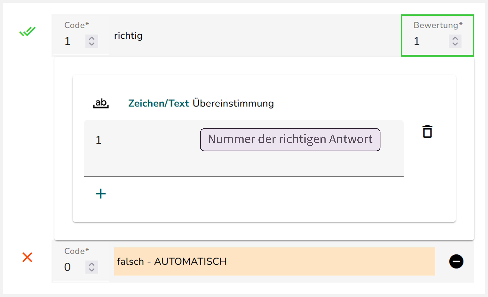

## Umbenennung des Interaktionselements „Optionsfeld“

Prüfen Sie zunächst, ob für das MC-Element (Optionsfeld) die richtige ID vergeben wurde. Die Umbenennung wird im Abschnitt @sec-umbenennung erklärt.

## Kodierschema der Basisvariable generieren

Wählen Sie im Reiter „Kodierung“ das Zauberstab-Symbol aus und wählen Sie die richtige Antwortoption. Klicken Sie auf „Generiere Kodierung“. 

::: {.panel-tabset}

## Kodierschema Basisvariable

Das erzeugte Kodierschema sollte ungefähr so aussehen:

{width="506"}

:::

