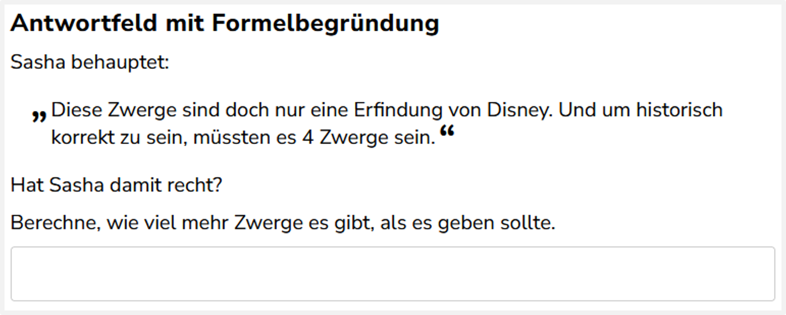
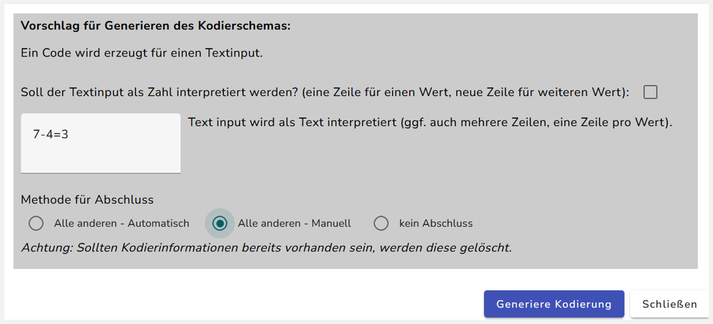
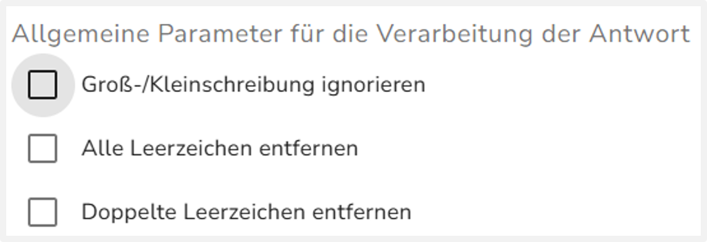
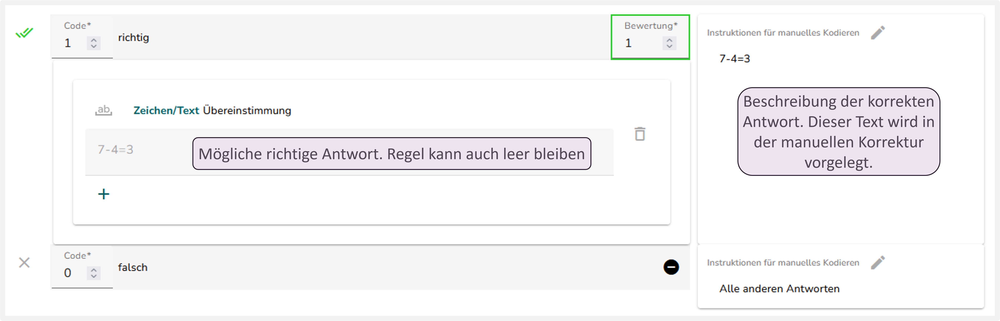

Bei diesem Aufgabentyp gibt es pro Eingabefeld genau eine richtige Antwort. Hier kann man eine halbautomatische Kodierung anlegen, die einen Teil der richtigen Antworten erkennt.

## Umbenennung des Interaktionselements „Eingabefeld“

Prüfen Sie zunächst, ob für jedes Textfeld („Eingabefeld“ oder „Eingabebereich“) eine ID vergeben wurde. [Hier](../../Allgemein/umbenennung.qmd) finden Sie die Anleitung zur Vergabe von IDs.

## Kodierschema der Basisvariable erstellen

Wählen Sie das Zauberstab-Symbol aus.

1.  Texteingabe: Geben Sie den richtigen Antworttext ein. Eine Antwort wird nur als richtig gewertet, wenn sie exakt mit diesem Text übereinstimmt. Wie Sie das anpassen können, wird im nächsten Abschnitt „Optional weitere Einstellungen für Antworten“ erklärt.

2.  Methode für Abschluss wählen: Wählen Sie eine der folgenden Optionen aus:

- „Alle anderen - Automatisch“: fügt Falsch-Code hinzu der alle Antworten automatisch falsch wertet, die nicht exakt mit der Lösung übereinstimmen. Die Antworten werden nicht mehr von einer Person überprüft.
- **„Alle anderen - Manuell“ (empfohlen)**: fügt einen Falsch-Code hinzu der alle Antworten zur manuellen Überprüfung weiterleitet, die von der Lösung abweichen. Das bedeutet, dass als falsch gewertete Antworten von einer Person geprüft werden.

Generieren Sie die Kodierung.

## Optional weitere Einstellungen für Antworten

Wenn die Texteingabe vor der Überprüfung auf Übereinstimmung angepasst werden soll, dann können Sie das unter „[Antwortverarbeitung und Fragmente](../../Allgemein/antwortverarbeitung.qmd)“ einstellen. Für die Textverarbeitung sind die folgenden drei Optionen relevant:

{width="424"}

Die Optionen werden in dem Kapitel [Antwortverarbeitung und Fragmente]() genauer erklärt.

## Instruktionen einfügen

Fügen Sie die Instruktionen für die Aufgabe hinzu. Wie das funktioniert wird [hier](../../Allgemein/instruktionen.qmd) erklärt.

::: panel-tabset
## Kodierschema

Das erzeugte Kodierschema sollte in etwa so aussehen: 
:::