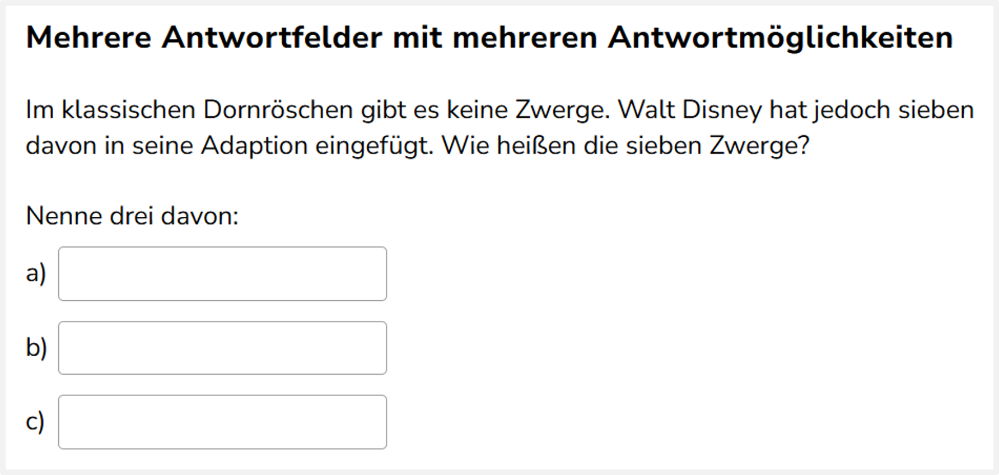
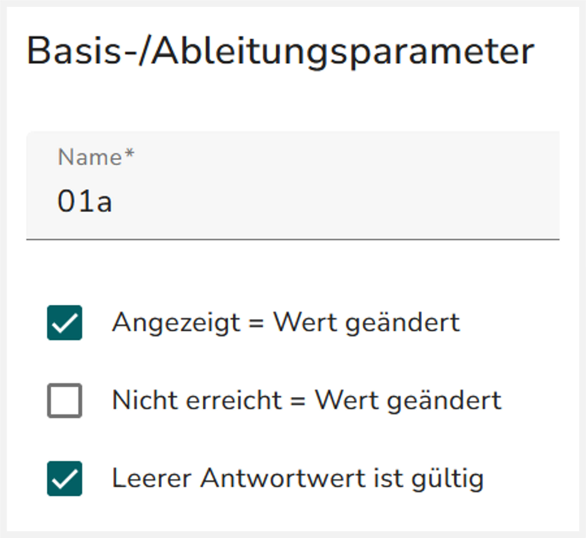
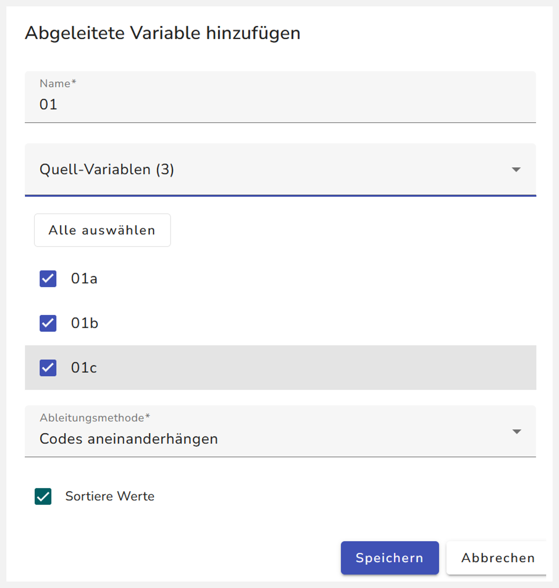
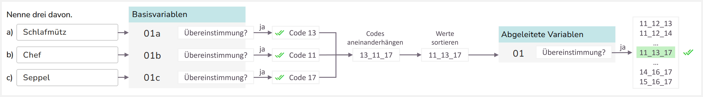
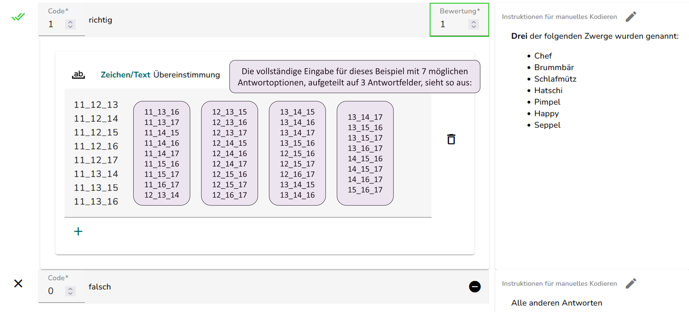

Diese Art von Aufgabe setzt sich aus mehreren Textfeldern zusammen.

{width="653"}

## Umbenennung des Interaktionselements „Eingabefeld“

Prüfen Sie zunächst, ob für jedes Textfeld („Eingabefeld“ oder „Eingabebereich“) eine ID vergeben wurde. [Hier](../../Allgemein/umbenennung.qmd) finden Sie die Anleitung zur Vergabe von IDs.

## Kodierschema einer Basisvariable erstellen

Legen Sie für jedes Textfeld (Basisvariable) das gleiche Kodierschema an.

1.  Richtig Codes anlegen:

    Fügen Sie für jede Antwortmöglichkeit einen Richtig-Code hinzu, die die Regel „Zeichen/Text Übereinstimmung“ enthält. Geben Sie jede Antwortoptionen in einen Richtig-Code ein. **Erklärung:** Wenn eine der eingefügten Antwortoptionen in das Textfeld eingegeben werden, wird dieses Textfeld zunächst als richtig gewertet. Im nächsten Schritt werden die richtigen Codes der verschiedenen Textfelder/Basisvariablen zusammengefügt, und die Zusammensetzung der richtigen Codes wird überprüft.

2.  Falsch-Code anlegen: Fügen Sie einen Falsch-Code ( oder ) ein:

- „Absichtlich unvollständig“ : falls die Aufgabe bei falscher Beantwortung manuell geprüft werden soll (z.B. bei Rechtschreib- oder Tippfehlern)
- Rotes Kreuz : falls die Aufgabe bei falscher Beantwortung nicht mehr manuell geprüft werden soll

3.  Nummerierung der Codes anpassen:

    Achten Sie darauf, dass die Codes richtig nummeriert sind. Klicken Sie dazu auf „Codes numerisch sortieren“ und halten Sie dabei die Taste „Strg“ ( + Strg)

::::: columns
::: {.column width="75%"}
4.  Basisparameter der Basisvariable setzen:

    Wählen Sie die [Basis-/Ableitungsparameter](../../Allgemein/ableitungsparameter.qmd) „Angezeigt = Wert geändert“ und „Leerer Antwortwert ist gültig“ aus. Optional können Sie auch „Nicht erreicht = Wert geändert“ auswählen, wenn sich die Aufgabe über eine langen Seite erstreckt und daher gescrollt werden muss. Was diese Parameter genau machen, können Sie [hier](../../Allgemein/ableitungsparameter.qmd) nachlesen.

    Es kann vorkommen, dass Schüler:innen bei Aufgaben mit mehreren Textfeldern alle Antworten in ein einzelnes Textfeld schreiben. Damit dieser Fall nicht automatisch als falsch gewertet wird, werden diese Parameter gesetzt, um festzulegen, wie leere Felder gewertet werden sollen.
:::

::: {.column width="25%"}
\
\

:::
:::::

## Kodierschema auf alle Basisvariablen (Textfelder) kopieren

Kopieren Sie das soeben angelegte Kodierschema auf die anderen Basisvariablen (Die Instruktionen werden dabei auch kopiert). Wie das geht, wird [hier]() erklärt.

## Abgeleitete Variable hinzufügen

::::: columns
::: {.column width="60%"}
Fügen Sie eine abgeleitete Variable hinzu. Die Variable soll prüfen, ob eine bestimmte Kombination aus Antwortcodes in den Basisvariablen vorgekommen ist. Geben Sie bei der Erstellung der abgeleiteten Variable Folgendes an:

- Name: übergeordnete ID (z.B.: `01` wenn IDs der Eingabefelder `01a`, `01b`, `01c` sind)
- Quellvariablen: alle Basisvariablen (Textfelder) der Aufgabe
- Ableitungsmethode: „Codes aneinanderhängen“
- „Sortierte Werte“ auswählen
:::

::: {.column width="40%"}

:::
:::::

## Kodierschema der abgeleiteten Variable erstellen

1.  Richtig-Code hinzufügen:

    Fügen Sie einen Richtig-Code mit der Regel „Zeichen/Text Übereinstimmung“ hinzu. Geben Sie in dem Feld alle erlaubten Aneinanderreihungen von Richtig-Codes aus den Basisvariablen an. Dabei wird jede Code-Nummer durch einen Unterstrich „\_“ getrennt aufgeschrieben. Beispiele:

- bei drei Antwortfeldern/Quellvariablen: 11_12_13

- bei zwei Quellvariablen: 11_12

  Schreiben Sie jede Kombination von Antwortmöglichkeiten in eine eigene Zeile. Hierbei ist die Reihenfolge der Antworten nicht zu beachten, da „Sortierte Werte“ angegeben wurde bei der Erstellung der abgeleiteten Variable. Es gilt also z.B. 11_12_13 = 13_12_11. Bedeutung: Code 11 UND Code 12 UND Code 13 müssen in den Quellvariablen ausgelöst werden, damit bei der abgeleitete Variable der Richtig-Code ausgelöst wird. Z.B. bei drei Antwortfeldern mit drei Antwortmöglichkeiten: 11_12_13 - Wenn z.B. nur zwei von drei Antworten genannt werden müssen: 11_12, 11_13, 12_12

2.  Falsch-Code hinzufügen:

    Fügen Sie den Falsch-Code „Falsch: Alle anderen Antworten“ hinzu.

## Übersicht Kodierschema

Die Übersicht veranschaulicht, wie das erstellte Kodierschema eine eingetragene, korrekte Antwort verarbeitet und überprüft:

Das erstellte Kodierschema sollte in etwa so aussehen:

::: panel-tabset
## Basisvariablen

Das Kodierschema von jeder Basisvariable sollte in etwa so aussehen: {width="483"}

## Abgeleitete Variable

Das Kodierschema der abgeleiteten Variable sollte in etwa so aussehen: 
:::