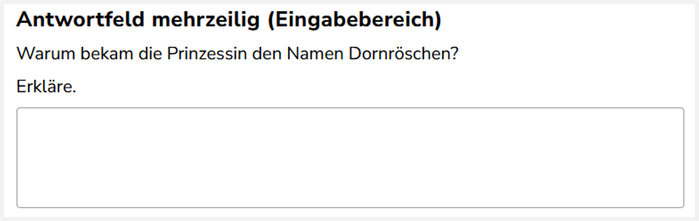

Dieses Aufgabenformat besteht aus einer offen gestelten Textaufgabe, sodass es viele Antwortmöglichkeiten gibt. Dadurch ist eine automatisierte Kodierung nicht möglich und die Aufgabe muss später manuell kodiert werden. Durch Einfügen eines bestimmten Falsch-Codes im Schemer wird die Aufgabe zur manuellen Kodierung zugewiesen. Zudem werden die Instruktionen für die manuelle Kodierung eingefügt.

## Umbenennung des Interaktionselements „Eingabefeld“

Prüfen Sie zunächst, ob für jedes Textfeld (Im IQB-Studio als „Eingabefeld“ oder „Eingabebereich“ bezeichnet) eine ID vergeben wurde. [Hier](../../Allgemein/umbenennung.qmd) finden Sie die Anleitung zur Vergabe von IDs.

## Kodierschema anlegen

1.  Richtig Code ohne Regeln hinzufügen: 
Fügen Sie einen Richtig-Code hinzu und löschen Sie daraus die Regel. Dort steht dann „Keine Regel gesetzt“

2.  Falsch Code hinzufügen: 
Fügen Sie den Falsch-Code „Falsch: Alle anderen Antworten“ hinzu. Dadurch wird die Aufgabe zur manuellen Korrektur weitergeleitet.

3.  Instruktionen hinzufügen:
Fügen Sie die Instruktionen für richtige und falsche Antworten hinzu. Wie das geht, wird [hier](../../Allgemein/instruktionen.qmd) beschrieben.

::: {.panel-tabset}

## Kodierschema

Das erzeugte Kodierschema sollte in etwa so aussehen:

:::

